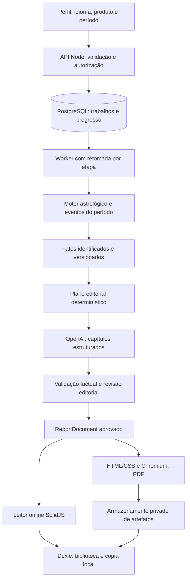

# LifeMap — refatoração de relatórios, previsões e experiência de leitura

Data: 10/10/2026. Status: proposta para revisão; implementação não iniciada.

## 1. Objetivo e entendimento do pedido

Incorporar a API da OpenAI para entregar relatórios PDF e previsões substanciais, personalizados e bem apresentados. Refatorar o fluxo completo: dados, cálculos preditivos, interpretação, geração, leitura online, PDF, loja e biblioteca.

O pedido exige profundidade e melhoria de layout. A proposta assume prioridade para qualidade editorial, com geração assíncrona que pode levar alguns minutos. Essa duração é uma expectativa de produto a medir no piloto, não um tempo já verificado. O modelo e o orçamento por relatório serão configuráveis.

Sucesso significa explicar os padrões mais relevantes do mapa, integrar indicadores que se complementam ou se contradizem, apresentar exemplos possíveis e orientações concretas, e fundamentar previsões em eventos calculados. Número de páginas é uma consequência do conteúdo e da composição.

## 2. Diagnóstico baseado no código atual

| Evidência | Consequência | Mudança proposta |
| --- | --- | --- |
| `astro.config.mjs` define `output: 'static'`; `.github/workflows/deploy.yml` publica no GitHub Pages | Não existe runtime para guardar uma chave de API ou executar trabalhos longos | Adicionar API e worker Node separados do frontend estático |
| `REPORTS-ARCHITECTURE.md` determina “Zero IA em runtime” | A documentação contradiz o novo objetivo solicitado | Substituir essa decisão por cálculos determinísticos e interpretação assistida por IA |
| `src/reports/pdf-generator.ts`: 1.674 linhas; `report-generators.ts`: 1.925 linhas | Texto, seleção de indicadores e desenho do PDF estão acoplados | Separar fatos, planejamento editorial, narrativa e apresentação |
| `generateAnnualPdf()` usa o ano do relógio e `currentYear - birthYear` | Usuário não escolhe período; idade ignora aniversário | Período explícito e profecção sensível à data |
| Fases lunares anuais usam `3 + (m * 2) % 15` e `17 + m % 10` | Datas exibidas são simbólicas, não fases calculadas | Consumir eventos calculados do calendário |
| Júpiter, Saturno e eixo nodal usados no anual vêm do mapa natal | Contexto natal é apresentado como clima do ano | Calcular trânsitos, ingressos, estações e contatos natais no período |
| `calculateSaturnReturn()` estima retorno por idade/ano de nascimento | Não identifica contatos exatos nem passagens retrógradas | Busca numérica dos retornos e suas janelas |
| `src/engine/calendar/` já calcula meses, fases, profecções e outros eventos | Há trabalho reaproveitável | Criar um agregador preditivo sobre essas funções e validar precisão/cobertura |
| `calendar/eclipses.ts` usa tabela limitada a 2024–2028 e horários locais ao meio-dia | Cobertura e precisão de horários não são universais | Registrar precisão, validar catálogo e bloquear períodos sem cobertura |
| `sweph-provider.ts` desativa o addon nativo no browser | O motor do site estático usa o fallback; comentários/documentação sobre WASM estão desatualizados | Usar Swiss Ephemeris no worker Node e identificar a procedência real de cada cálculo |
| `generateFullReport()` não recebe locale; vários trechos usam `isEN` | Um PDF pode misturar idiomas apesar das 11 rotas localizadas | Um contrato de locale para conteúdo, interface, datas e fontes |
| `wrapText()` desenha o bloco inteiro; `checkPage()` testa a posição depois | Textos maiores podem ultrapassar a página | Paginação por HTML/CSS de impressão, com inspeção visual |
| `renderWheelPage()` tenta inserir SVG via jsPDF e tem placeholder de fallback | O PDF pode perder sua visualização central | Incorporar SVG diretamente no documento HTML de impressão |
| `ReportPreview` não mapeia financeiro, espiritual e Saturno em `PRODUCT_MAP`; o carrinho não despacha todos os produtos | Produto registrado ou PDF entregue pode ser o natal por fallback | Registro central de produtos; tipo desconhecido vira erro explícito |
| Fluxos de relatório não propagam consistentemente um segundo perfil; o relatório de relacionamento aceita ausência de parceiro | Análise de casal pode sair incompleta ou genérica | Dois perfis obrigatórios para sinastria completa |
| `payment.ts` aprova sempre; perfis e compras vivem apenas no Dexie | A API de IA não pode confiar nessa compra local para autorizar gasto | Entitlement validado no servidor e piloto privado antes da venda pública |
| `WeeklyHoroscopeApp` limita amor a 60 caracteres e não recebe locale | A interface também reduz a profundidade e a localização | Síntese semanal própria, leitura expansível e locale explícito |
| Não há script de testes em `package.json` nem suíte automatizada identificada | A refatoração precisa estabelecer verificação | Testes de cálculo, contratos, trabalho assíncrono e renderização |

Documentos históricos como `PROJETO.md` servem como contexto; o código atual prevalece onde divergem. A investigação foi de código e documentação: não foi feito benchmark de PDFs nem chamada paga à API.

## 3. Alternativas e decisão

| Caminho | Benefício | Limitação |
| --- | --- | --- |
| **Recomendado: frontend Astro/Solid atual + backend Node e worker próprios** | Preserva as páginas e o motor existentes; suporta addon nativo, Chromium e trabalhos longos | Introduz infraestrutura e operação |
| Migrar todo o Astro para servidor | Facilita origem única e sessões | Muda hospedagem e coloca páginas públicas no mesmo ciclo de implantação do processamento |
| Ampliar textos locais e manter somente jsPDF | Menor mudança operacional e mantém geração local | Não atende à integração OpenAI e mantém limites de síntese/paginação |

Refatorar toda a cadeia de relatórios e previsões, em entregas graduais. Manter Astro, SolidJS, Tailwind, renderização SVG e módulos úteis do motor. Migração de framework não oferece benefício suficiente para este pedido.

## 4. Arquitetura proposta



Responsabilidades:

- **Motor:** calcular posições, casas, aspectos, fases e períodos. Registrar engine, fonte, precisão e limitações. Nenhuma data/posição astronômica vem do modelo.
- **Fatos:** transformar saídas do motor em evidências com IDs estáveis, unidades explícitas e UTC serializado. O navegador envia dados de nascimento; o backend recalcula os fatos usados no relatório premium.
- **Plano editorial:** selecionar prioridades, capítulos, evidências e faixas de extensão por produto. Evitar dar o catálogo inteiro ao modelo.
- **Narrativa:** redigir capítulos e integrar temas com a OpenAI a partir do plano e das evidências.
- **Validação:** conferir schema, IDs, fatos mencionados, cobertura, extensão, duplicação e locale. A revisão por modelo melhora texto, mas não substitui verificação dos dados.
- **Documento:** armazenar o conteúdo aprovado, independente de formato visual. O mesmo JSON alimenta leitor e PDF.
- **Trabalho:** persistir progresso e tentativas. Reiniciar um worker não perde capítulos já aprovados.

PostgreSQL guarda a fila inicialmente; não adicionar Redis nesta etapa. Worker reivindica trabalhos com lock, lease e heartbeat. O armazenamento de artefatos tem interface local para desenvolvimento e armazenamento privado de objetos em produção. Serviço e worker rodam em containers Node compatíveis com `sweph` e Chromium; não assumir que um runtime edge suporta esses componentes.

## 5. Contratos e interfaces

Criar `src/reports/core/` para contratos sem dependências de DOM, Dexie ou OpenAI. Criar serviços em `services/report-api/` e `services/report-worker/`.

```typescript
type ReportType =
  | 'natal' | 'annual' | 'relationship' | 'psychological' | 'career'
  | 'seven-sins' | 'financial' | 'spiritual' | 'saturn-return' | 'child' | 'forecast';
type ForecastGranularity = 'daily' | 'weekly' | 'monthly' | 'annual';
type BirthTimeQuality = 'exact' | 'approximate' | 'unknown';
type GenerationMode = 'sample' | 'complete';
type JobStage = 'queued' | 'calculating' | 'planning' | 'writing'
  | 'reviewing' | 'rendering' | 'ready' | 'failed' | 'cancelled';

interface ForecastPeriod {
  start: string; // ISO 8601 UTC, inclusivo
  end: string;   // ISO 8601 UTC, exclusivo
  timeZoneId: string;
  basis: 'calendar' | 'next-12-months' | 'birthday-cycle' | 'custom';
}
interface ReportSubject {
  birth: import('../../engine/types').BirthData;
  timeQuality: BirthTimeQuality;
  timeUncertaintyMinutes?: number; // obrigatório e positivo quando approximate
}
interface ReportRequest {
  reportType: ReportType;
  subjects: ReportSubject[]; // relacionamento completo exige exatamente 2
  locale: import('../../i18n').Locale;
  mode: GenerationMode;
  houseSystem: import('../../engine/types').HouseSystem;
  period?: ForecastPeriod;
  forecastGranularity?: ForecastGranularity; // obrigatório para forecast
  focus?: string; // opcional, máx. 1.000 caracteres, tratado como dado
}
interface AstroFact {
  id: string;
  kind: string; // enum fechado no schema por tipo de fato
  values: Record<string, string | number | boolean | null>;
  subjectIndex: number;
  source: string;
  precision: 'computed' | 'approximate' | 'unavailable';
}
interface ForecastEvent {
  id: string;
  factIds: string[];
  kind: string;
  startUtc: string;
  peakUtc: string | null;
  endUtc: string;
  timingPrecision: 'minute' | 'day' | 'approximate';
  importance: number; // peso editorial, não probabilidade de evento pessoal
  themes: string[];
}
interface ReportContext {
  facts: AstroFact[];
  events: ForecastEvent[];
  limitations: string[];
  engineVersion: string;
  factsHash: string;
}
interface PlannedChapter {
  id: string;
  titleKey: string;
  factIds: string[];
  eventIds: string[];
  minWords: number;
  maxWords: number;
}
interface ReportPlan {
  reportType: ReportType;
  chapters: PlannedChapter[];
  requiredFactIds: string[];
  editorialVersion: string;
}
interface NarrativeSection {
  id: string;
  heading: string;
  paragraphs: string[];
  evidenceIds: string[];
  eventIds: string[];
  possibleExpressions: string[];
  recommendations: string[];
  reflectionQuestions: string[];
}
interface ChapterDraft { id: string; title: string; sections: NarrativeSection[] }
interface QualityIssue { code: string; chapterId: string | null; message: string }
interface QualityResult { accepted: boolean; issues: QualityIssue[] }
interface ReportDocument {
  schemaVersion: 1;
  id: string;
  locale: import('../../i18n').Locale;
  reportType: ReportType;
  title: string;
  summary: string[];
  chapters: ChapterDraft[];
  context: ReportContext;
  plan: ReportPlan;
  metadata: {
    generatedAt: string;
    period: ForecastPeriod | null;
    model: string;
    promptVersion: string;
    layoutVersion: string;
  };
}
```

Enums de tipos de fato, evento e tema devem derivar do motor existente e ser fechados no schema executável. Campos astrológicos no texto usam referências resolvidas pelo renderer sempre que possível; o modelo não precisa reproduzir graus ou datas em prosa. `forecast` é o tipo interno das leituras pessoais diária/semanal/mensal; não cria um novo SKU automaticamente. Esses pedidos exigem `period` e `forecastGranularity`.

Funções públicas planejadas:

- `buildReportContext(request: ReportRequest): Promise<ReportContext>`.
- `buildForecastDataset(request: ReportRequest): Promise<ForecastEvent[]>`.
- `planReport(request: ReportRequest, context: ReportContext): ReportPlan`.
- `generateChapter(chapter: PlannedChapter, context: ReportContext, locale: Locale): Promise<ChapterDraft>`.
- `validateReport(document: ReportDocument): QualityResult`.
- `renderReportHtml(document: ReportDocument, presentation: PresentationData): string`.
- `renderReportPdf(document: ReportDocument, presentation: PresentationData): Promise<Uint8Array>`.

`PresentationData` contém somente nomes de exibição e dados de capa autorizados. Esses dados não precisam ir à OpenAI. Schemas Zod validam entradas/saídas; schemas usados com Structured Outputs devem respeitar o subconjunto suportado pela API.

## 6. Integração OpenAI e qualidade editorial

Usar SDK oficial no servidor e **Responses API**, com **Structured Outputs**. Essa combinação permite solicitar capítulos em schema definido, mas não garante veracidade do conteúdo. Validar domínio e referências no LifeMap. Fontes: [geração de texto](https://developers.openai.com/api/docs/guides/text) e [Structured Outputs](https://developers.openai.com/api/docs/guides/structured-outputs?api-mode=responses).

Fluxo de geração:

1. Validar dados e produzir contexto calculado.
2. Montar plano editorial determinístico, com evidências prioritárias por capítulo.
3. Redigir capítulos com um contexto global resumido e evidências específicas. Persistir cada capítulo aprovado.
4. Verificar capítulos por código. Reescrever somente os reprovados, no máximo uma vez por falha editorial.
5. Fazer uma revisão global de redundância e coerência, mantendo IDs e vínculos às evidências.
6. Revalidar tudo, gerar resumo com base no conteúdo aprovado, montar JSON e PDF.

O modelo recebe instruções versionadas, exemplos de boa profundidade e trechos curados das bases existentes. Revisar conteúdo em `docs/` antes de usá-lo: é material de referência editorial, não comprovação de diagnóstico ou de acontecimentos pessoais. Inicialmente a seleção é por tags e IDs; embeddings e vector database só serão considerados se a avaliação mostrar necessidade.

Cada seção principal deve explicar: padrão, combinação dos indicadores, manifestações possíveis, tensão/potencial e aplicação prática. Não afirmar biografia, trauma, doença, renda futura ou eventos concretos como fatos derivados do mapa. As previsões continuam sendo interpretações astrológicas; a integração não constitui demonstração de precisão na previsão de acontecimentos.

Seleção de modelo: avaliar `gpt-6-astra` como candidato para máxima qualidade e `gpt-6.1-sol` para comparação de custo/qualidade, sem fixar um vencedor sem medir relatórios reais. Disponibilidade na conta, versões e preços devem ser confirmados na implementação. O catálogo oficial descreve esses perfis; isso não prova superioridade no caso LifeMap. Fonte: [comparação de modelos](https://developers.openai.com/api/docs/models/compare).

Configurações server-only: `OPENAI_API_KEY`, `OPENAI_REPORT_MODEL`, `OPENAI_REVIEW_MODEL`, `REPORT_MAX_COST_USD`, `OPENAI_PRICE_TABLE_VERSION`, `DATABASE_URL`, credenciais do armazenamento, `REPORT_ALLOWED_ORIGINS` e limites de concorrência. No frontend, apenas `PUBLIC_REPORT_API_URL`.

Orçamento: estimar tokens antes de aceitar o trabalho; reservar custo das etapas previstas, incluindo revisão e retries. Aplicar teto por trabalho e por projeto. Calcular custo com tokens de entrada, cache, saída e raciocínio conforme os campos de uso e a tabela vigente, sem contabilizar raciocínio duas vezes. Não publicar um custo fixo por PDF antes do piloto. Fonte: [preços da API](https://developers.openai.com/api/docs/pricing).

Cache de conteúdo é privado por proprietário e leva em conta fatos, período, idioma, produto, foco, modelo e versões editorial/schema/prompt. Cache do PDF inclui também dados de apresentação, versão de layout e fontes. A mesma edição aprovada é reutilizada; não prometer que duas gerações independentes produzem o mesmo texto.

Retries: respeitar `Retry-After`, retry com backoff/jitter somente para erros transitórios e no máximo 2 retries por chamada. Recusa, resposta truncada, schema incompatível e erro de orçamento são estados explícitos. Não entregar documento parcial como relatório completo nem trocar silenciosamente para um modelo mais barato.

## 7. Previsões: reconstrução do conteúdo temporal

Unificar dados preditivos sobre `src/engine/calendar/`, `src/engine/index.ts` e `src/engine/progressions.ts`:

- Trânsitos reais sobre posições natais e ângulos confiáveis, com entrada/saída de orbe, pico e múltiplas passagens retrógradas.
- Profecção calculada na data correta; reconhecer mudança de ciclo dentro do período.
- Fases lunares reais, ingressos e estações com precisão declarada.
- Eclipses com fonte e cobertura explícitas; ausência de catálogo válido bloqueia o anual completo para o período, sem inventar eventos.
- Revolução solar com instante, lugar de referência e contatos relevantes.
- Progressões secundárias com método documentado e contatos com o natal; validar convenção de casas/ângulos antes de publicá-los.
- Retorno de Saturno encontrado numericamente, com passagens e janelas. Idade aproximada serve somente como contexto.

Amostragem diária do calendário atual pode servir para descobrir candidatos, mas não certifica pico exato. Refinar cruzamentos com busca adaptativa; investigar mínimos em estações que apenas tangenciam o orbe. Definir precisão da busca temporal e da origem dos dados separadamente.

Defaults: anual = próximos 12 meses a partir da data escolhida; usuário também pode selecionar ano civil ou ciclo de aniversário. O relatório sempre mostra início, fim e fuso. Não usar ano atual como dependência escondida.

Daily, weekly e monthly usam o mesmo dataset e um plano editorial adequado. Semanal integra a semana, não concatena sete resumos. Horóscopo por signo é apresentado como leitura geral e pode ser pré-gerado com cache compartilhado por signo/período/idioma; contexto pessoal nunca entra nesse cache público.

Hora desconhecida: omitir Ascendente, casas e ângulos; tratar Lua e aspectos dependentes do horário como intervalos/limitações. O backend investiga o dia local inteiro; eventual horário de referência usado pelo contrato legado não é declarado hora de nascimento. Hora aproximada: usar `timeUncertaintyMinutes` para registrar sensibilidade e evitar conclusões que mudam na faixa de incerteza. A OpenAI não completa dados faltantes.

## 8. Conteúdo por produto

Faixas abaixo são metas editoriais iniciais, ajustáveis após piloto. Validação em PT/EN/ES usa palavras; JA/ZH exige métrica própria de caracteres/segmentação, calibrada por edição. Não inflar conteúdo para preencher páginas.

| Produto | Estrutura necessária | Meta inicial de extensão |
| --- | --- | --- |
| Natal | Síntese integrada; identidade; emoções; pensamento; vínculos; ação; carreira/recursos; conflitos; talentos; direção de desenvolvimento; exercícios e apêndice | 8.000–12.000 palavras; aproximadamente 28–45 páginas |
| Anual | Resumo; técnicas e limites; ciclo anual; temas dominantes; 12 capítulos mensais; janelas importantes; síntese trimestral; integração e calendário técnico | 10.000–15.000 palavras; aproximadamente 35–55 páginas |
| Relacionamento | Dois mapas; sinastria; sobreposições; composto pelo motor existente; comunicação; intimidade; convivência; recursos; tensões e acordos | 7.000–10.000 palavras |
| Psicológico | Integração dos padrões, necessidades e estratégias; exemplos possíveis; exercícios de reflexão | 6.000–9.000 palavras |
| Carreira / financeiro | Indicadores específicos e integrados; estilo de trabalho/recursos; potenciais, limites e plano de reflexão/ação | 5.000–8.000 palavras cada |
| Espiritual / Saturno | Eixos e ciclos específicos; interpretação simbólica; práticas; no Saturno, cronologia calculada | 5.000–8.000 palavras cada |
| Sete pecados / criança | Linguagem adequada ao produto, abordagem lúdica no primeiro; necessidades e apoio ao desenvolvimento no segundo | 3.500–6.000 palavras cada |
| Diário / semanal / mensal pessoal | Panorama, áreas relevantes, janelas, fundamentos e sugestões práticas | 400–700 / 1.200–2.000 / 2.000–3.500 palavras |

Capítulo mensal do anual: 450–650 palavras, eventos relevantes, contexto natal, manifestações possíveis, recomendações e perguntas. Se não há eventos importantes, explicar continuidade dos ciclos existentes sem fabricar destaque.

Produto infantil existe no catálogo atual, mas ainda precisa de blueprint e fluxo completos; seu rollout fica por último. Os nove relatórios com páginas de amostra devem migrar antes dele.

## 9. Novo layout: site, leitor e PDF

Direção visual: conservar identidade escura/dourada na navegação e usar uma superfície editorial clara para textos longos. PDF em branco quente, texto escuro e dourado discreto; gráficos com cores que também tenham símbolos/rótulos. Reduzir a dependência de cards translúcidos para leitura extensa.

### Site e fluxo de relatórios

- Loja com filtros atuais e cards claros: propósito, conteúdo, amostra real e seleção de perfil antes de adicionar. O período e os dois perfis aparecem quando pertinentes.
- Preparação do relatório: perfil, segundo perfil, idioma, período e foco opcional. Resumo dos dados antes de gerar; explicação simples do processamento remoto.
- Geração: etapas reais, capítulos concluídos e retomada. Não inventar percentual/estimativa de tempo. Usuário pode sair e voltar.
- Biblioteca: relatórios prontos, em geração ou com erro; capa, perfil, período, idioma, edição, abrir e baixar. PDF/JSON já baixados funcionam offline pelo Dexie.
- Dashboard e navegação passam a distinguir “Previsões”, “Relatórios” e “Minha biblioteca”, mantendo rotas antigas e redirecionamentos úteis.

### Leitor online

Desktop: sumário fixo à esquerda, conteúdo central entre 65 e 75 caracteres por linha, detalhes técnicos em painel recolhível. Mobile: coluna única, sumário em drawer, filtros de mês/tema e botão de download acessível.

```text
┌──────────────────────────────────────────────────────────────┐
│ Nome do relatório · perfil · período             Baixar PDF  │
├─────────────────┬────────────────────────────────────────────┤
│ Resumo          │ O que merece sua atenção                    │
│ Temas centrais  │ Síntese personalizada e prioridades         │
│ Janeiro         │                                            │
│ Fevereiro       │ Linha do tempo: início → pico → integração  │
│ ...             │                                            │
│ Fundamentos     │ Capítulo: texto + aplicações + perguntas    │
│                 │ [Ver fundamentos astrológicos]              │
└─────────────────┴────────────────────────────────────────────┘
```

### PDF editorial

- Capa com produto, perfil e período; ficha dos dados e limites; resumo de 1–2 páginas; sumário navegável; capítulos; gráficos; exercícios; apêndice técnico e glossário.
- A4, margens de 18–22 mm, corpo de 10,5–11,5 pt, entrelinha de 1,45–1,6. Não reduzir fonte para caber uma seção.
- Títulos serifados, corpo sem serifa e famílias com cobertura específica para os 11 idiomas. Fontes locais e carregadas antes da renderização; glifos astrológicos em SVG quando necessário.
- Wheel SVG nítido, tabelas de posições, distribuição de elementos e linha do tempo. Visualizações representam dados reais, sem percentuais fictícios de probabilidade/compatibilidade.
- Cabeçalho discreto, rodapé paginado, quebras entre capítulos, controle de títulos órfãos e repetição de cabeçalho em tabelas longas. Blocos maiores que uma página devem poder quebrar.
- Renderizar HTML/CSS em Chromium via Playwright; solicitar `printBackground`, `preferCSSPageSize`, `outline` e `tagged`. Esses recursos existem, mas qualidade de bookmarks/acessibilidade precisa ser inspecionada. Fonte: [Playwright PDF](https://playwright.dev/docs/api/class-page#page-pdf).
- Sumário com links e outline inicialmente. Números exatos no sumário só entram com paginação de duas passagens validada; Chromium não deve ser presumido capaz de resolver qualquer contador CSS de página.

A IA entrega texto estruturado, não HTML/CSS. Apresentação é controlada pelo produto, com escaping/sanitização e assets internos.

## 10. API, persistência e proteção do orçamento

Rotas propostas:

- `POST /v1/sessions/guest`: cria identidade anônima e token opaco; guardar hash no servidor. Não exige criar conta.
- `POST /v1/reports`: request validado e `Idempotency-Key`; retorna `202 { jobId, stage }`. Repetir chave com outro payload retorna 409.
- `GET /v1/reports/:jobId`: progresso e falhas; acesso apenas do proprietário.
- `GET /v1/reports/:jobId/document`: JSON aprovado, disponível após validação editorial.
- `GET /v1/reports/:jobId/pdf`: artefato privado; indisponível enquanto a renderização não conclui.
- `POST /v1/reports/:jobId/retry`: retoma o estágio falho; não reprocessa pagamento nem capítulos aprovados.
- `POST /v1/reports/:jobId/cancel`: encerra etapas futuras; chamada já enviada pode consumir uso.
- `DELETE /v1/reports/:jobId`: cancela pendências e remove dados/artefatos no servidor.
- `GET /v1/forecasts/public`: retorna leitura geral já publicada, sem gerar uma chamada paga por pageview.

Sessão convidada identifica o proprietário, mas não autoriza gasto automaticamente. Relatório completo exige entitlement server-side. Na fase piloto, somente sessões habilitadas internamente. Na produção pública, usar checkout/webhook verificado com produto/preço definidos no servidor. Amostra pública permanece local ou pré-gerada; amostra pessoal com IA requer quota protegida. Rate limit e CORS complementam esses controles, não substituem autorização.

Jobs, capítulos, edições, entitlements e reservas de custo ficam no PostgreSQL. Resultados privados em armazenamento de objetos. Snapshot impede que edição de perfil durante a geração altere o relatório. PDFs antigos do Dexie são mantidos como edições anteriores.

Sessão anônima permite retomada no mesmo dispositivo. Sincronização entre dispositivos e recuperação por conta ficam fora desta entrega; não prometer recuperação de um token perdido. IDs locais de perfil nunca são identidade server-side.

Nome e dados de capa são inseridos após a geração. Não enviar gênero, notas livres e nome à OpenAI por padrão. `focus` é opcional e limitado. Dados de nascimento vão ao backend para cálculo; logs não devem registrar payloads pessoais. Usar `store: false` na OpenAI, sem afirmar retenção zero: controles de monitoramento do provedor são distintos. Fonte: [controles de dados da OpenAI](https://developers.openai.com/api/docs/guides/your-data).

Política proposta para o piloto: entrada bruta criptografada até conclusão ou 24h; contexto, JSON e PDF privados por 30 dias; cópia local até exclusão pelo usuário. Trabalhos que ultrapassem a retenção da entrada exigem reenvio explícito. Exclusão também considera backups com prazo documentado. Explicar essa política na interface antes de ativar geração remota. Atualizar promessas atuais de processamento “100% local”.

## 11. Critérios de aceite e avaliação

- **Fatos:** 100% dos IDs citados existem; todos os indicadores prioritários do plano são abordados. Zero datas/posições criadas pelo modelo nos campos técnicos.
- **Prosa:** verificar referências numéricas/nomeadas contra fatos e inspecionar amostras manualmente. IDs válidos por si só não demonstram que um parágrafo está correto.
- **Profundidade:** cada capítulo principal integra pelo menos dois indicadores quando disponíveis, com exemplos possíveis e aplicação prática. Rubrica editorial de especificidade, integração, clareza, utilidade e não repetição: cada dimensão ≥ 4/5 no piloto revisado.
- **Extensão:** respeitar a faixa definida pelo blueprint; documento curto ou truncado é reprovado. Não preencher com repetições.
- **Predição:** cálculos reproduzíveis para período e engine; múltiplas passagens preservadas; limites em UTC e datas exibidas no fuso escolhido; precisão e cobertura declaradas.
- **Visual:** nenhuma linha cortada, sobreposição ou glifo faltante nas fixtures longas; wheel presente; tabelas legíveis; texto pesquisável e navegação funcionando.
- **Idiomas:** PT/EN/ES no piloto; teste visual e editorial de JA/ZH/ru e os demais antes de habilitar relatório completo em cada locale. Fallback deve ser explícito.
- **Operação:** refresh, retry e reinício de worker não duplicam pedido/pagamento; chamadas por estágio são registradas. Timeout ambíguo do provedor pode ter consumido tokens: considerar esse risco na reserva e no log, sem prometer exatamente uma cobrança externa.
- **Orçamento:** teto e quota exercitados; relatório de custo por produto/idioma/modelo; cache não compartilha conteúdo pessoal entre usuários.
- **Regressão:** mapas e compras antigas seguem acessíveis; produto, período e parceiros corretos em cada caminho de compra.

Montar 24 perfis sintéticos diversos para regressão e comparar 12 relatórios editoriais com a versão atual: 4 natais, 4 anuais, 2 relacionamentos e 2 temáticos. Cobrir fronteiras de signo, aniversário, DST, ano bissexto, latitudes altas, horário incerto e nomes longos. Avaliação com API real é uma etapa futura com custo registrado; esta proposta não executou o benchmark.

## 12. Entregas e sequência

1. Contratos, catálogo e fixtures; baseline dos relatórios atuais.
2. Dataset factual/preditivo validado e procedência do motor.
3. API, autorização, persistência e fila com retomada.
4. OpenAI, blueprints e qualidade: natal e anual no piloto.
5. Documento visual, PDF editorial e leitor online.
6. Loja, preparação, biblioteca e integração do fluxo assíncrono.
7. Demais relatórios e previsões online; cobertura dos idiomas.
8. Avaliação, migração gradual e liberação por flags.

Ordem de lançamento: natal → anual → relacionamento → carreira/financeiro/psicológico → espiritual/Saturno/sete pecados → criança. Daily/weekly/monthly entram após dataset e pipeline estarem validados. Primeiro validar offline com fixtures, depois piloto privado, depois venda pública.

Fora do escopo inicial: trocar Astro/SolidJS, chat aberto com astrólogo virtual, ferramentas web autônomas, fine-tuning, biblioteca vetorial, e-mail automático, contas/sincronização e reescrever todas as ferramentas gratuitas. Nenhum desses itens é necessário para tornar os relatórios profundos.

## 13. Decisões pendentes para execução

O planejamento não depende destas respostas, mas produção depende de chave/projeto OpenAI, teto financeiro aprovado, infraestrutura Node/PostgreSQL/objetos, origem da API e credenciais de pagamento. O piloto definirá modelo efetivo, concorrência, tempo p50/p95 e custo médio. Os preços de produtos existentes não serão alterados automaticamente.

Plano operacional associado: `../plans/2026-10-10-openai-relatorios-refatoracao.md`.

## 14. Adendo Cloudflare-native (10/10/2026, decisão do usuário)

Site estático em Cloudflare Pages; nada de containers/Postgres autogeridos.
Secrets em Workers secrets; login/pagamento/email via terceiros
(Clerk/Auth0, Stripe, Resend); jobs longos em Workflows/Queues; estado em
D1+R2; PDF via Browser Rendering `/pdf`. Tarefas 1–2 intactas (agnósticas a
runtime); lógica OpenAI/blueprints (T4) e conteúdo por produto (T7) preservados.

Exceção verificada no spike (`docs/reports/ephemeris-spike.md`,
`scripts/reports/ephemeris-spike.ts`): o addon `sweph` não executa em
Workers. Path serverless usa o fallback com regras por proveniência —
planetas/Lua/fases/estações suficientes (≤ 0.2'), Lilith corrigida e
mean-grade, Quíron omitido quando mean-elements, nodos fora de contatos
cronometrados no fallback. WASM da Swiss Ephemeris adiado (não necessário
para o v1). Tarefas 3 (runtime), 5 (PDF), 6 (entitlements) e 8 (ops) mudam
de forma; custos passam a pay-per-use a medir no piloto.

## 15. Adendo híbrida rules-first (10/10/2026, decisão do usuário)

MVP vende sem IA em runtime (4A); IA só como síntese opcional com teto
(4B). Auditoria: repositório real com 46 pares de aspectos × 3 registros,
planetas em casas/signos e síntese por 6 temas; `RuleEngine`/`ScoringEngine`/
`ReportAssembler` não existem como código e há zero linhas de dedup —
o gap é montagem (scoring, dedup, síntese-primeiro, contradições), não
conteúdo. Baseline: natal completo atual tem 26 páginas mas ~3.560 palavras
(meta 8–12k); páginas ≠ profundidade.

4A monta `ReportDocument` deterministicamente a partir do catálogo
versionado (textos existentes + expansões com IA em dev-time, revisadas e
commitadas) até a faixa de palavras, sem padding. 4B recebe só resumos
priorizados e reescreve sínteses preservando IDs/fatos, com envelope-teto
(30k in / 20k out por relatório, 1 retry, modelo pequeno, `store: false`,
nomes fora do payload); indisponibilidade cai para 4A, nunca parcial.
Custo validado: ~US$ 0,0165/relatório no envelope (GPT-4o mini, preços
$0.15/$0.60 por 1M verificados em 10/10/2026) — o teto, não o piso.
A/B 4A×4B na rubrica editorial (≥4/5) decide o rollout do premium.
